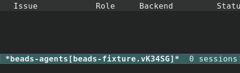
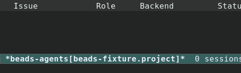
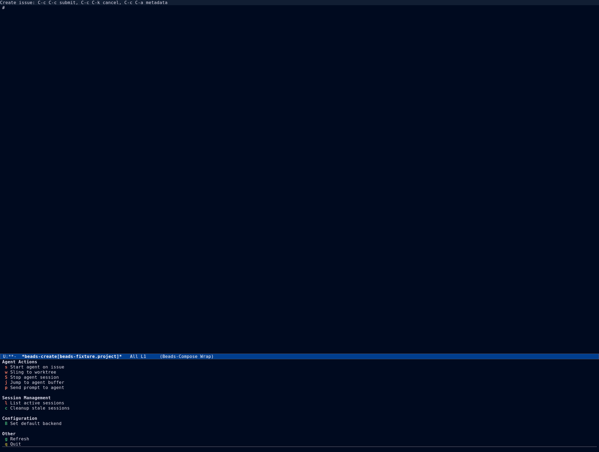
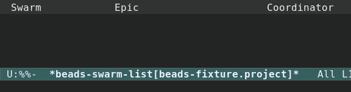
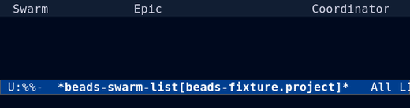

#+TITLE: Agents and Sling
#+AUTHOR: Beads Contributors
#+LANGUAGE: en
#+OPTIONS: H:4 num:3 toc:2
#+STARTUP: showall
#+SETUPFILE: ../.orgconfig

# Task area: agent types and backends, sessions, worktrees, sling, prompts.

Back to [[file:index.org][the manual index]].

* Overview

beads.el can launch an AI agent on an issue from inside Emacs.  A *session*
is the combination of an agent *type* (what the agent is asked to do) and a
*backend* (the program and terminal that run it), optionally isolated in a git
worktree.  Sessions are tracked in an in-house registry, so no external
session-manager package is required.

* Agent commands

Agent commands are bound under the {{{kbd(a)}}} prefix in list and show
buffers, and the full menu is on {{{kbd(a)}}} in the dispatch menu.

- {{{kbd(a t)}}} :: Start a task agent.
- {{{kbd(a r)}}} :: Start a review agent.
- {{{kbd(a p)}}} :: Start a plan agent.
- {{{kbd(a q)}}} :: Start a QA agent.
- {{{kbd(a c)}}} :: Start a custom agent.
- {{{kbd(a x)}}} :: Stop the agent at point.
- {{{kbd(a j)}}} :: Jump to the agent buffer.
- {{{kbd(a a)}}} :: Start the generic agent at point.

#+CAPTION: The agent session list (=beads-agent-list=).
#+NAME: fig:agents-dark

#+CAPTION: The agent menu (=beads-agent=).
#+NAME: fig:agent-menu-dark

* Agent types

An *agent type* fixes the role and the prompt protocol.  The built-in types
are Task, Review, Plan, QA, and Custom.  Each type has two prompts:

- a role-only *system* prompt ({{{fn(beads-agent-type-system-prompt)}}}), and
- an issue-envelope *user* prompt
  ({{{fn(beads-agent-type-build-user-prompt)}}}).

Settings are kept in =beads-agent-type.el=.  Custom types register in the same
way and appear in the menu.

* Agent backends

A *backend* knows how to start one program in one terminal.  Backends
register in a registry (=beads-agent-backend.el=); the shipped set includes:

- =claude-code=, =claude-code-ide=, =claudemacs=, =eca=, and =agent-shell=,
- =mock= for tests, and
- =terminal=, an opt-in collision-free backend that spawns a CLI directly
  into a terminal.

The start method is =beads-agent-backend-start=, called with
=(backend issue system-prompt user-prompt)=.  Backends are selected by name;
{{{var(beads-agent-curated-backends)}}} limits the menu to a preferred subset
and leaves the rest selectable but out of the way.

* Sessions and worktrees

A session is registered in the in-house registry as soon as it starts, so it
can be revisited after a restart.  When git worktree isolation is enabled,
the agent runs in its own worktree with its own branch, so parallel agents do
not fight over the working tree.  The worktree helpers live in =beads-git.el=
and are shared with the terminal and swarm modules.

* Sling and swarm

*Sling* dispatches a bead to an agent or another target.  *Swarm* runs many
agents over the children of an epic in waves.

- {{{kbd(S)}}} from the dispatch menu :: Open the swarm fleet list
  (=beads-swarm-list-view=).
- {{{kbd(w)}}} from the maintenance menu :: The swarm sub-dispatch.

#+CAPTION: The swarm fleet list, showing wave progress.
#+NAME: fig:swarm-dark

The sling preview shows the prompt and target before the agent starts, so you
can adjust them before committing.  Sling and swarm share the terminal
subsystem; see [[file:orchestration.org][Orchestration and terminal]].
