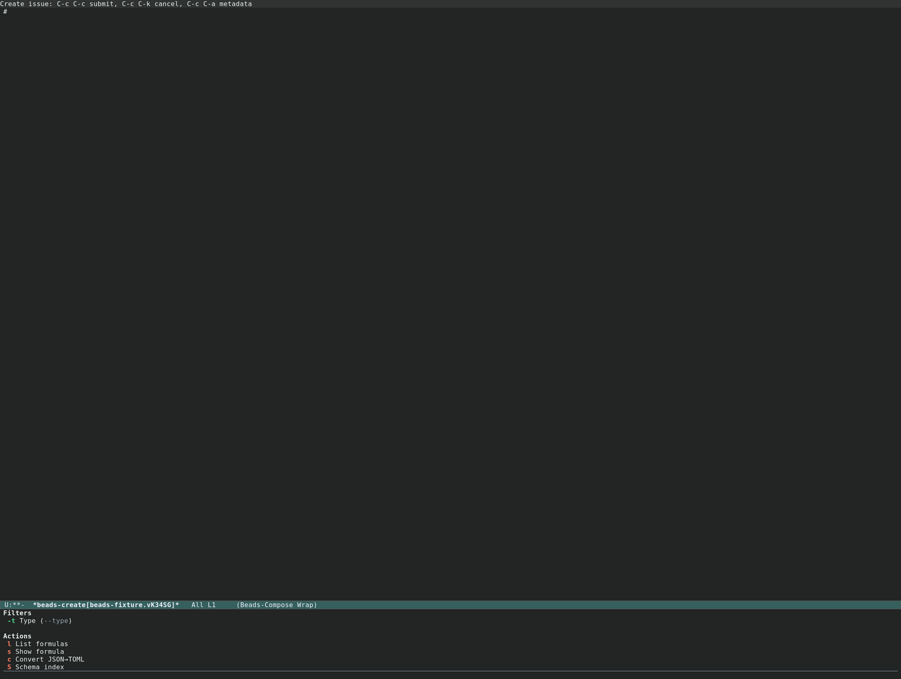
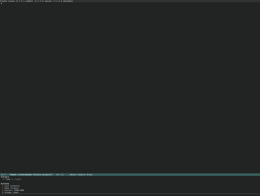
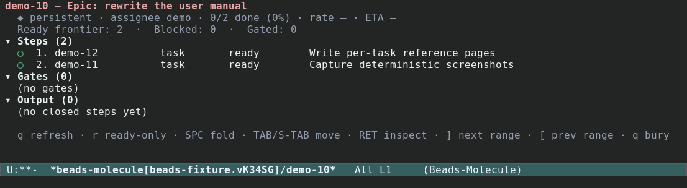
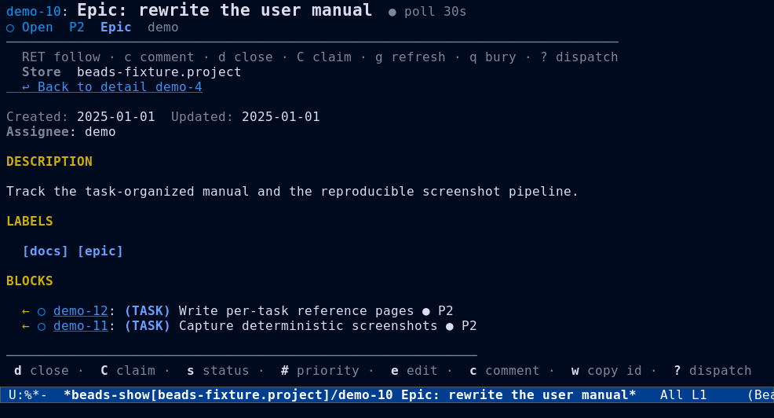
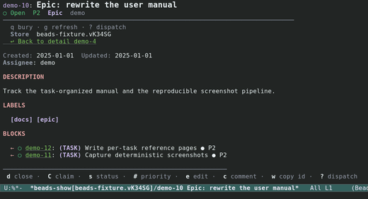
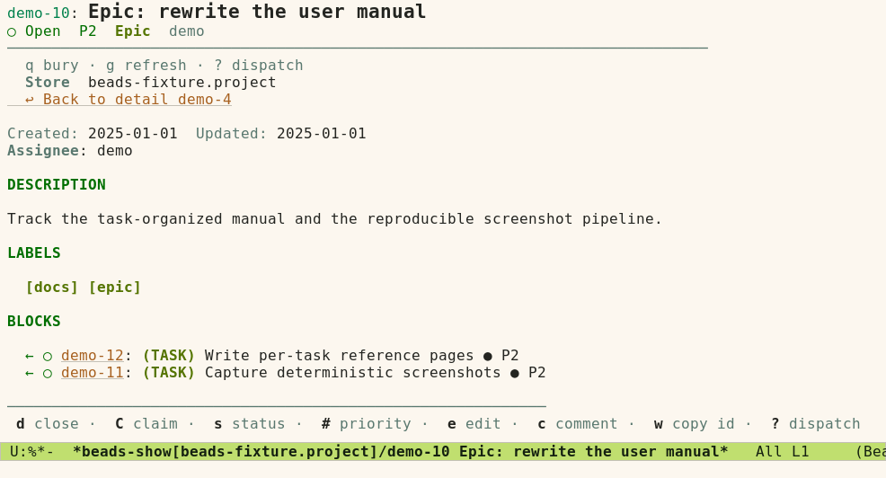
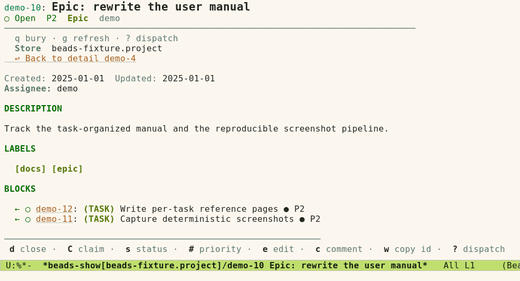

#+TITLE: Formulas, Molecules, and Epics
#+AUTHOR: Beads Contributors
#+LANGUAGE: en
#+OPTIONS: H:4 num:3 toc:2
#+STARTUP: showall
#+SETUPFILE: ../.orgconfig

# Task area: formulas, molecules, epics, bond/pour/burn, health.

Back to [[file:index.org][the manual index]].

* Formulas

#+FINDEX: beads-formula-menu
Formulas are YAML or TOML definitions that describe repeatable workflows.
They are *cooked* into proto beads, which can then be *poured* or *wisped*.
Press {{{kbd(F)}}} from the dispatch menu to open the formula menu.

- {{{kbd(l)}}} :: List available formulas.  Filter by type
  (=workflow=, =expansion=, or =aspect=) in the browser or with a prefix
  argument to =beads-formula-browse=.
- {{{kbd(s)}}} :: Show a formula's details: phase, version, =extends=,
  aspects, expansion formulas, composition bond points, and each step's type,
  dependencies, gate, and waits-for, plus every variable's type, enum,
  pattern, default, and required flag.
- {{{kbd(c)}}} :: Convert a formula from JSON to TOML.

The formula browser marks a formula whose name shadows a same-name formula
lower on the {{{cmd(bd)}}} search path with a =⧉shad= badge; its help-echo
names the shadowed path.  The scope filter switches between =project=,
=user=, and =all=.

#+CAPTION: The formula menu (=beads-formula-menu=).
#+NAME: fig:formula-dark

* Molecules

#+FINDEX: beads-mol
A /proto/ is a template epic; a /molecule/ is a running instance made from
it.  Press {{{kbd(m)}}} from the dispatch menu for the molecule menu.

** Instantiate

- {{{kbd(p)}}} :: Pour — create a persistent molecule from a proto.
- {{{kbd(w)}}} :: Wisp — create an ephemeral molecule.

** Combine

- {{{kbd(b)}}} :: Bond — merge molecules together.
- {{{kbd(d)}}} :: Distill — extract a proto from existing issues.

** Lifecycle

- {{{kbd(s)}}} :: Show molecule details.
- {{{kbd(c)}}} :: Show the current active molecule.
- {{{kbd(P)}}} :: Show molecule progress.

** Cleanup

- {{{kbd(S)}}} :: Squash — collapse molecule history.
- {{{kbd(B)}}} :: Burn — destroy a molecule.

** Find and health

- {{{kbd(r)}}} :: Ready — find molecules ready for work.
- {{{kbd(t)}}} :: Stale — find stale molecules.
- {{{kbd(e)}}} :: Seed — verify molecule seed data integrity.
- {{{kbd(l)}}} :: Last activity — show when each molecule was last touched.

#+CAPTION: The molecule view of the fixture epic, showing poured steps.
#+NAME: fig:molecule-dark

* Epics

#+FINDEX: beads-epic-menu
Press {{{kbd(E)}}} from the dispatch menu for the epic menu.

- {{{kbd(s)}}} :: Status overview — an interactive buffer listing every epic
  with progress bars, child counts, and closure eligibility.
  {{{kbd(SPC)}}} expands or collapses children; {{{kbd(RET)}}} opens an epic.
- {{{kbd(c)}}} :: Close eligible — close every epic whose children are all
  complete.  Pass =--dry-run= to preview first.

#+CAPTION: An epic detail view with its children.
#+NAME: fig:epic-dark

#+CAPTION: The epic view under the light theme.
#+NAME: fig:epic-light

* Cook, pour, and burn from one place

The maintenance menu ({{{kbd(!)}}}) also carries the workflow verbs:
{{{kbd(K)}}} cook, {{{kbd(w)}}} swarm, {{{kbd(g)}}} gate, {{{kbd(H)}}} ship,
and the state helpers {{{kbd(z)}}} and {{{kbd(Z)}}}.  See
[[file:orchestration.org][Orchestration and terminal]] for the full maintenance menu.
