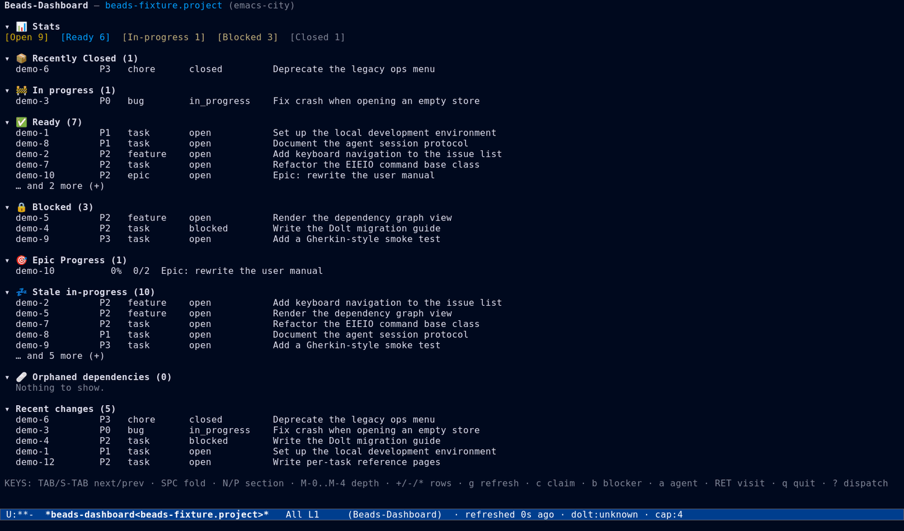
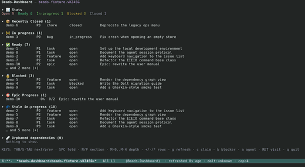

#+TITLE: Beads.el User Manual
#+AUTHOR: Beads Contributors
#+LANGUAGE: en
#+TEXINFO_DIR_CATEGORY: Emacs
#+TEXINFO_DIR_TITLE: Beads: (beads).
#+TEXINFO_DIR_DESC: Magit-like interface for the Beads issue tracker.
#+OPTIONS: H:4 num:3 toc:2
#+STARTUP: showall
#+SETUPFILE: ../.orgconfig

# This file is the table of contents and landing page of the manual under
# =docs/manual/=.  Each task area has its own page; screenshots are committed
# under =docs/manual/images/= as =<view>-<theme>.png= plus a =-thumb= variant.

This manual is for Beads.el version 0.1.0.

#+TEXINFO: @insertcopying

* Introduction

Beads.el is a Magit-like Emacs interface for the [[https://github.com/steveyegge/beads][Beads]] issue tracker.
It provides a keyboard-driven, transient-based UI for managing issues,
dependencies, molecules, formulas, agents, and workflows without leaving
Emacs.

Beads.el is a porcelain over the {{{cmd(bd)}}} command-line tool: the UI never
parses human-readable output, it always drives {{{cmd(bd --json)}}} and renders
the structured result.  Every {{{cmd(bd)}}} command is reachable from Emacs,
either through an auto-generated transient or a curated one.

** Related resources

- Beads CLI: https://github.com/steveyegge/beads
- Magit (interaction model): https://magit.vc
- Forge (sections and references): https://magit.vc/manual/forge
- Design record for the board and menus: =plans/beads-ui-redesign/design.md=
- Enforced key contract: =docs/key-registry.md=

* Table of contents

The manual is organized by task.  Start with the page that matches what you are
trying to do.

- [[file:index.org][Getting started and interface concepts]] — installation, your first
  issue, and the patterns every view shares (this page).
- [[file:issue-workflow.org][Issue workflow]] — create, list, view, edit, close/reopen, claim,
  status, priority, dependencies, labels, and bulk actions.
- [[file:views.org][Dashboards and views]] — the project board and dashboard, list and show
  sections, pagination, movement, and eldoc previews.
- [[file:formulas.org][Formulas, molecules, and epics]] — cook, pour, bond, burn, and epic
  health.
- [[file:agents.org][Agents and sling]] — agent types and backends, sessions, worktrees,
  sling, and prompts.
- [[file:orchestration.org][Orchestration and terminal]] — the dispatch and maintenance menus,
  terminal backends, Dolt and repos, remotes, configuration, and audit.
- [[file:maintenance.org][Maintenance and extending]] — customizing and faces, the plumbing,
  the extension points, an FAQ, and the indexes.

* Installation

** Requirements

- Emacs 29.1 or newer.
- The {{{cmd(bd)}}} executable on {{{var(PATH)}}}.
- The MELPA libraries =transient= (0.10.1+), =sesman= (0.3.2+), and =vui=
  (1.0.0+).
- {{{cmd(dolt)}}} and {{{cmd(graphviz)}}} for the full feature set and test
  suite.

** Installing from MELPA

#+BEGIN_SRC emacs-lisp
(use-package beads
  :ensure t)
#+END_SRC

** Installing from source

Clone the repository and add its =lisp/= directory to your load path:

#+BEGIN_SRC emacs-lisp
(add-to-list 'load-path "/path/to/beads.el/lisp")
(require 'beads)
#+END_SRC

** Initial setup

Initialize a Beads store in a project directory:

#+BEGIN_SRC shell
cd /path/to/project
bd init
#+END_SRC

Then open the board in Emacs with {{{kbd(M-x beads)}}}.  beads.el finds the
store from the buffer's =default-directory=; see [[*Store scoping]] below when
you need to act on a different project.

* Your first issue

1. Open the board: {{{kbd(M-x beads)}}}.
2. Press {{{kbd(?)}}} for the dispatch menu, then {{{kbd(c)}}} to create an
   issue.
3. Type the title on the first line, then the description below it.
4. Press {{{kbd(C-c C-c)}}} to submit.  The new issue appears in refreshed
   lists.

From the board, press {{{kbd(?)}}} again and use:

- {{{kbd(l)}}} to list all issues,
- {{{kbd(r)}}} to list ready (unblocked) work,
- {{{kbd(b)}}} to list blocked work,
- {{{kbd(D)}}} to open the full project dashboard.

* Interface concepts

Beads.el uses three interaction patterns, modeled on Magit and Forge.
Understanding them tells you where a command lives and what a key will do.

** Modes and buffers

The interface is built from a small set of modes.  The porcelain board uses
=vui= for heterogeneous, collapsible sections, and =tabulated-list-mode= for
homogeneous tables.

- {{{dfn(beads-dashboard-mode)}}} :: The full project board, opened by
  {{{kbd(M-x beads)}}}.  Each section loads asynchronously and folds
  independently.
- {{{dfn(beads-list-mode)}}} :: A =tabulated-list-mode= derivative for browsing
  issues.  It supports sorting, filtering, marking, and bulk operations.
- {{{dfn(beads-show-mode)}}} :: A read-only section view for one issue, with
  section navigation, reference following, and inline editing.

Buffer names carry the project so several stores can be open at once, and are
qualified by branch or remote when needed (see =beads-buffer.el=):

- =*beads-dashboard[PROJECT]*=
- =*beads-list[PROJECT]*=, =*beads-ready[PROJECT]*=, =*beads-blocked[PROJECT]*=
- =*beads-show[PROJECT]/ISSUE-ID*=
- =*beads-agent[PROJECT]/TYPE#N*=

** Transients: dispatch and maintenance

Beads.el keeps Magit's status/dispatch split:

1. *Board* ({{{kbd(M-x beads)}}}) :: The front door is the board, not a
   transient.  {{{kbd(M-x beads)}}} runs {{{fn(beads-dashboard)}}}.
2. *Dispatch menu* ({{{kbd(?)}}}) :: {{{fn(beads-dispatch)}}} is the command
   menu, opened with {{{kbd(?)}}} from any beads buffer (or
   {{{kbd(M-x beads-dispatch)}}}).  It groups the common flows into *Issues*,
   *Workflow*, *Views*, and *Manage*, and builds a context group from the view
   at point.
3. *Maintenance menu* ({{{kbd(!)}}}) :: {{{fn(beads-maintenance)}}} is the
   single admin and infrastructure menu.  It is the successor of the former
   =beads-ops-menu= and =beads-advanced-menu=, which no longer exist.

The menus are ordinary transient prefixes defined with
=beads-define-prefix=.  Every suffix runs in the directory the menu was opened
for, so a menu opened from another project acts on that project's store.  The
bulk of the per-command menus is generated from command-class slot metadata;
see [[file:maintenance.org][Maintenance and extending]].

** Context-aware actions

/Pattern 1/ commands are single-key actions bound directly in mode maps.  They
detect the issue at point (falling back to =completing-read=) and act
immediately.

Examples in =beads-list-mode= and =beads-show-mode=:

- {{{kbd(C)}}} :: Claim the issue at point.
- {{{kbd(d)}}} :: Close the issue at point (prompts for a reason).
- {{{kbd(o)}}} :: Reopen a closed issue.
- {{{kbd(s)}}} :: Set status.
- {{{kbd(#)}}} :: Set priority.
- {{{kbd(E)}}} :: Edit the description.
- {{{kbd(N)}}} :: Add a comment.

** Compose buffers

/Pattern 3/ commands open a compose buffer for content creation or editing.
The buffer uses =gfm-mode= (or =text-mode= as a fallback) and follows the
=with-editor= convention: the first line is the title, everything after the
first blank line is the Markdown description.

- {{{kbd(C-c C-c)}}} :: Submit (create the issue, save the edit, post the
  comment).
- {{{kbd(C-c C-k)}}} :: Cancel and restore the previous window configuration.
- {{{kbd(C-c C-a)}}} :: Open the metadata sidebar (type, priority, labels,
  parent).

** Marks and bulk operations

In =beads-list-mode= you can mark several issues and act on them as a batch:

- {{{kbd(m)}}} :: Mark the issue at point.
- {{{kbd(u)}}} :: Unmark the issue at point.
- {{{kbd(U)}}} :: Unmark all issues.
- {{{kbd(* !)}}} :: Mark all issues.

When marks are active, context-aware actions such as {{{kbd(d)}}} and
{{{kbd(o)}}} operate on every marked issue.  Bulk-specific operations live
under the {{{kbd(B)}}} prefix: {{{kbd(B s)}}} status, {{{kbd(B p)}}} priority,
{{{kbd(B c)}}} close, {{{kbd(B o)}}} reopen.

** One movement scheme

Every view moves with one primitive, =beads-thing=: {{{kbd(TAB)}}} and
{{{kbd(S-TAB)}}} move between things and wrap, and {{{kbd(SPC)}}} toggles the
thing at point (folding a section, previewing an issue, and so on).  In
tabulated lists each row is a thing without visible stamping.  See
[[file:views.org][Dashboards and views]] for details.

** Store scoping

The high-level entry points =beads-show=, =beads-ready=, =beads-blocked=,
=beads-list-issues= and =beads-dashboard= accept an optional =:directory=
keyword.  When non-nil, the operation is scoped to the Beads store at that
directory instead of the one resolved from =default-directory=.  This matters
when a shared Dolt server could otherwise route the working directory to
another project's database.

#+BEGIN_SRC emacs-lisp
(beads-show "bd-42" :directory "/path/to/project")
(beads-dashboard :directory "/path/to/project")
#+END_SRC

The directory becomes the buffer's store (the buffer-local
=beads-store-directory=): every {{{cmd(bd)}}} command run from that buffer
whose =directory= slot is unset gets {{{cmd(--directory)}}}, so refreshes and
actions keep acting on that store, and buffers opened from it inherit it.

#+CAPTION: The project board ({{{fn(beads-dashboard)}}}), the front door of beads.el.
#+NAME: fig:dashboard-dark

