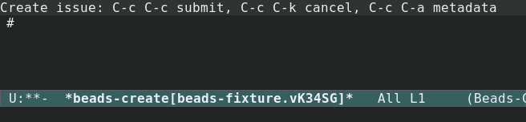
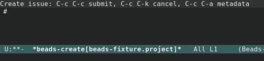
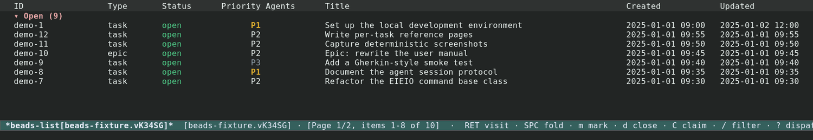
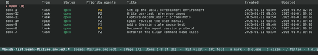
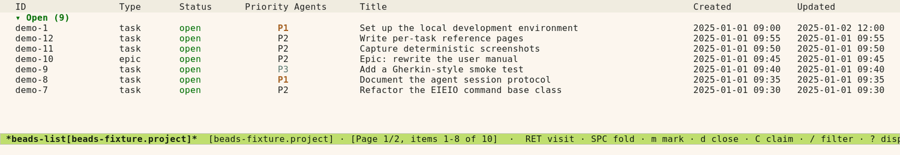
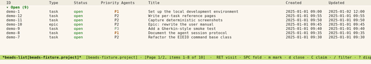
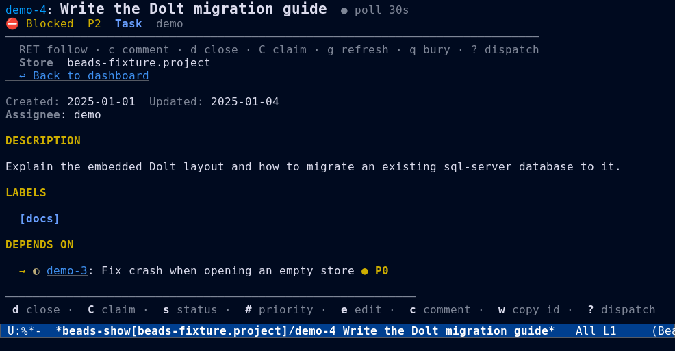
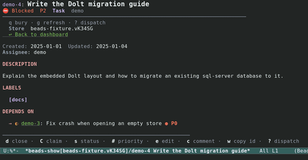
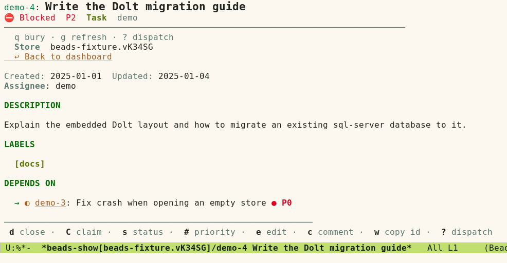
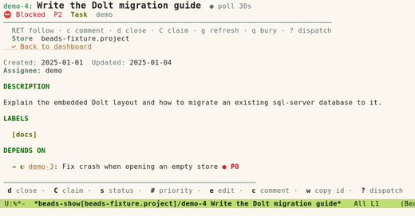

#+TITLE: Issue Workflow
#+AUTHOR: Beads Contributors
#+LANGUAGE: en
#+OPTIONS: H:4 num:3 toc:2
#+STARTUP: showall
#+SETUPFILE: ../.orgconfig

# Task area: create, list, view, edit, close/reopen, claim, status, priority,
# dependencies, labels, and bulk actions.  Back to [[file:index.org]].

Back to [[file:index.org][the manual index]].

* Creating issues

#+FINDEX: beads-compose-create
Creating an issue uses the compose buffer.  Press {{{kbd(c)}}} from the
dispatch menu (or {{{kbd(M-x beads-compose-create)}}}) to open a
=*beads-create[PROJECT]*= buffer.

The first line is the title (an optional {{{code(# )}}} prefix is stripped).
Everything after the first blank line is the Markdown description.

#+BEGIN_EXAMPLE
# Fix login redirect loop

When users log in with SSO they get stuck in a redirect loop
between /auth/callback and /login.

## Steps to reproduce
1. Click "Sign in with SSO"
2. Complete the SSO flow
3. Observe the redirect loop
#+END_EXAMPLE

** Setting metadata

#+KINDEX: C-c C-a
Press {{{kbd(C-c C-a)}}} for the metadata sidebar:

- {{{kbd(t)}}} :: Type (bug, feature, task, epic, chore, ...).
- {{{kbd(p)}}} :: Priority (0–4).
- {{{kbd(a)}}} :: Assignee.
- {{{kbd(l)}}} :: Labels (comma-separated).
- {{{kbd(P)}}} :: Parent issue.

Press {{{kbd(q)}}} to dismiss it and return to editing.

** Submitting and canceling

#+KINDEX: C-c C-c
#+KINDEX: C-c C-k
{{{kbd(C-c C-c)}}} submits; the title is required and the description is
optional.  On success the buffer is killed and open lists are refreshed.
{{{kbd(C-c C-k)}}} cancels; you are asked to confirm if there are unsaved
changes.

#+CAPTION: The compose buffer (=beads-compose-create=) for a new issue.
#+NAME: fig:compose-dark

* Listing issues

*Opening the list.*  From the dispatch menu press {{{kbd(l)}}}.  The list menu
uses switch-based infixes: toggle filters, then press a suffix to execute.

- *Filters* :: {{{kbd(-s)}}} status, {{{kbd(-t)}}} type, {{{kbd(-p)}}}
  priority, {{{kbd(-a)}}} assignee, {{{kbd(-l)}}} label.
- *Options* :: {{{kbd(-o)}}} sort order, {{{kbd(-n)}}} limit.

Press {{{kbd(l)}}} again inside the menu to list all issues.  The suffix
converts the filter state into a =beads-issue-spec= and refreshes the list
buffer.

- {{{kbd(r)}}} :: List ready (unblocked) issues.
- {{{kbd(b)}}} :: List blocked issues.
- {{{kbd(/)}}} :: In a list buffer, open the spec-based filter menu to refine
  the current view.
- {{{kbd(M-x beads-list-advanced)}}} :: The advanced list transient exposes the
  remaining {{{cmd(bd list)}}} flags.

** Sorting, pagination, and movement

- {{{kbd(S)}}} sorts by the column under point.
- {{{kbd(])}}} / {{{kbd([)}}} move between pages; {{{kbd(G)}}} jumps to a page.
  See [[file:views.org][Dashboards and views]].
- {{{kbd(TAB)}}} / {{{kbd(S-TAB)}}} move between rows and wrap;
  {{{kbd(SPC)}}} previews the issue at point in another window.

#+CAPTION: The issue list (=beads-list-mode=), a sortable, filterable table.
#+NAME: fig:list-dark

#+CAPTION: The same list under the light theme.
#+NAME: fig:list-light

* Viewing issues

#+FINDEX: beads-show
Press {{{kbd(RET)}}} on a row to open the issue in a show buffer.  The buffer
renders every field as collapsible sections with clickable issue references.

- {{{kbd(n)}}} / {{{kbd(p)}}} :: Next / previous section.
- {{{kbd(TAB)}}} / {{{kbd(S-TAB)}}} :: Next / previous heading or reference
  (wraps).
- {{{kbd(SPC)}}} :: Fold or unfold the section at point.
- {{{kbd(RET)}}} :: Follow the reference at point.
- {{{kbd(o)}}} :: Follow it in another window.
- {{{kbd(g)}}} :: Refresh.
- {{{kbd(q)}}} :: Quit.

#+CAPTION: The issue detail view (=beads-show-mode=) with dependencies and comments.
#+NAME: fig:show-dark

#+CAPTION: The issue detail view under the light theme.
#+NAME: fig:show-light

* Editing issues

- {{{kbd(E)}}} :: Edit the description in a compose buffer.
- {{{kbd(N)}}} :: Add a comment in a compose buffer.
- {{{kbd(e)}}} :: Edit a field inline (single-line title, or a temporary
  buffer for longer fields).

From a show buffer, {{{kbd(?)}}} opens a persistent actions transient that
stays open after each action, so you can run several without reopening it.

* Closing and reopening

#+FINDEX: beads-actions-close
#+KINDEX: d
{{{kbd(d)}}} closes the issue at point.  {{{cmd(bd)}}} requires a reason, so
you are prompted for one.  When marks are active it closes every marked issue
with the same reason.

#+FINDEX: beads-actions-reopen
#+KINDEX: o
{{{kbd(o)}}} reopens a closed issue, prompting for an optional reason.  In
=beads-show-mode= reopen lives in the actions transient because {{{kbd(o)}}}
follows references in another window.

* Claiming, status, and priority

- {{{kbd(C)}}} :: Claim the issue at point.  This runs immediately; the
  current actor is assigned.
- {{{kbd(s)}}} :: Set status (=open=, =in_progress=, =blocked=, ...).
- {{{kbd(#)}}} :: Set priority, from =0 - Critical= through =4 - Backlog=.

All three honour marks in list mode.

* Dependencies

#+FINDEX: beads-dep
Press {{{kbd(d)}}} from the dispatch menu for the dependency menu.

- {{{kbd(a)}}} :: Add a dependency (source depends on target, plus type).
- {{{kbd(r)}}} :: Remove a dependency.
- {{{kbd(l)}}} :: List dependencies for an issue.
- {{{kbd(t)}}} :: Show the full dependency tree, walking transitively.
- {{{kbd(c)}}} :: Check the project for dependency cycles.
- {{{kbd(R)}}} :: Create a bidirectional =relates_to= link.
- {{{kbd(U)}}} :: Remove a =relates_to= link.

* Labels

#+FINDEX: beads-label
Press {{{kbd(L)}}} from the dispatch menu for the label menu.

- {{{kbd(a)}}} :: Add a label to one or more issues.
- {{{kbd(r)}}} :: Remove a label from one or more issues.
- {{{kbd(p)}}} :: Propagate a label to all children of an issue.
- {{{kbd(l)}}} :: List labels for a specific issue.
- {{{kbd(L)}}} :: List all labels in the store.

* Bulk actions

Mark issues in a list buffer ({{{kbd(m)}}}), then use a context action such as
{{{kbd(d)}}}, {{{kbd(o)}}}, {{{kbd(s)}}}, or {{{kbd(#)}}} to apply it to every
marked issue.  The {{{kbd(B)}}} prefix adds dedicated bulk commands
({{{kbd(B s)}}}, {{{kbd(B p)}}}, {{{kbd(B c)}}}, {{{kbd(B o)}}}).
