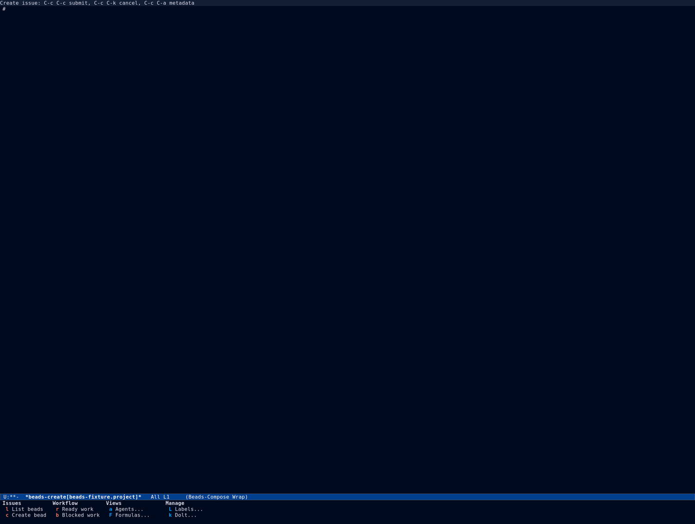
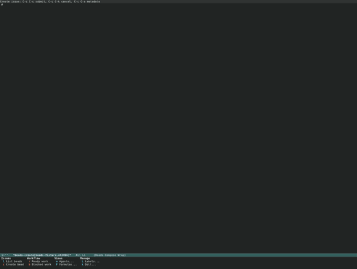
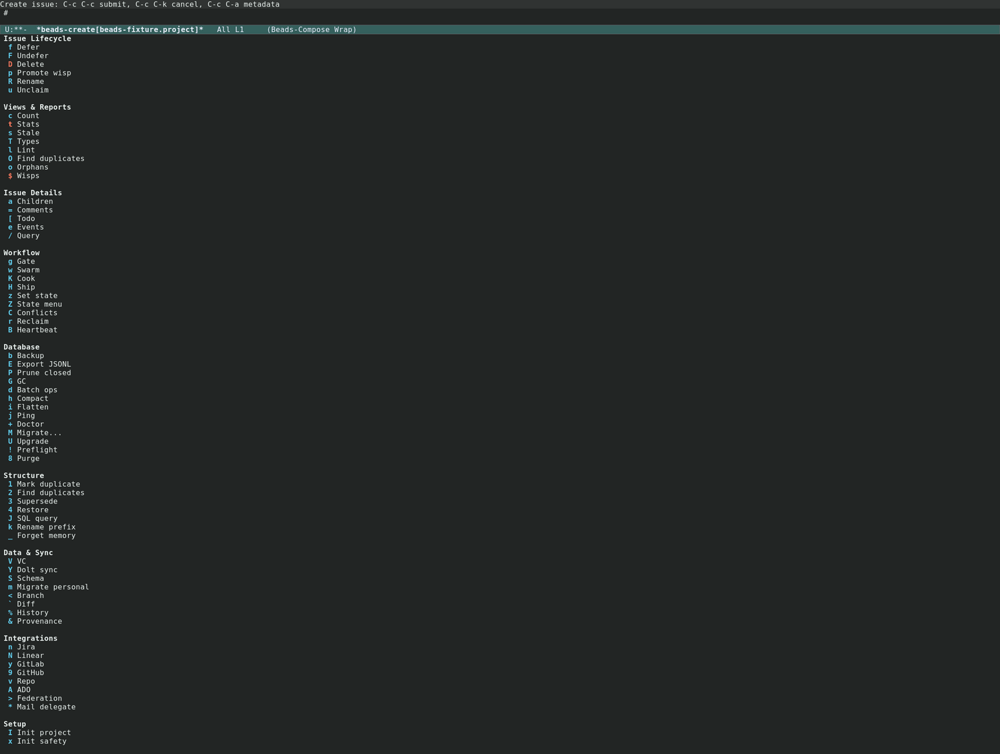
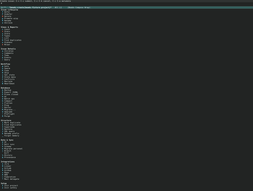

#+TITLE: Orchestration and Terminal
#+AUTHOR: Beads Contributors
#+LANGUAGE: en
#+OPTIONS: H:4 num:3 toc:2
#+STARTUP: showall
#+SETUPFILE: ../.orgconfig

# Task area: dispatch and maintenance menus, terminal backends, Dolt and
# repos, remotes, configuration, audit.

Back to [[file:index.org][the manual index]].

* The dispatch and maintenance menus

The whole CLI surface is reachable from two menus:

- {{{fn(beads-dispatch)}}} on {{{kbd(?)}}} — the high- and mid-frequency
  commands, grouped into *Issues*, *Workflow*, *Views*, and *Manage*.
- {{{fn(beads-maintenance)}}} on {{{kbd(!)}}} — the low-frequency, admin, and
  infrastructure commands, replacing the former =beads-ops-menu= and
  =beads-advanced-menu=.

Downstream packages can append their own groups through
{{{var(beads-menu-providers)}}}; the group appears under the dispatch menu
without editing beads.el.

#+CAPTION: The dispatch menu (=beads-dispatch=).
#+NAME: fig:dispatch-dark

#+CAPTION: The maintenance menu (=beads-maintenance=).
#+NAME: fig:maintenance-dark

** Maintenance groups

The maintenance menu is organized by intent:

- *Issue Lifecycle* :: defer, undefer, delete, promote wisp, rename, unclaim.
- *Views & Reports* :: count, stats, stale, types, lint, duplicates, orphans,
  wisps.
- *Issue Details* :: children, comments, todo, events, query.
- *Workflow* :: gate, swarm, cook, ship, set-state, state menu, conflicts,
  reclaim, heartbeat.
- *Database* :: backup, export JSONL, prune, GC, batch ops, compact, flatten,
  ping, doctor, migrate, upgrade, preflight, purge.
- *Structure* :: mark duplicate, find duplicates, supersede, restore, SQL
  query, rename prefix, forget memory.
- *Data & Sync* :: version control, Dolt sync, schema, migrate personal,
  branch, diff, history, provenance.
- *Integrations* :: Jira, Linear, GitLab, GitHub, repo, ADO, federation, mail.
- *Setup* :: init, init safety, integrations, info, version, bootstrap, hooks,
  quickstart, where, context, memories, KV store, prime, recall, remember,
  audit, admin, worktrees.

* Terminal backends

#+FINDEX: beads-terminal
Agents and interactive CLIs run in a terminal managed by the EIEIO terminal
subsystem (=beads-terminal.el=).  Backends register with
=beads-terminal-register= and are selected in ascending priority order by
=beads-terminal-auto=.  The built-ins are:

- =vterm=, =ghostel=, =eat=, =ansi-term=, and =term=,
- plus =auto=, which never spawns itself but picks the first available
  concrete terminal.

Remote (TRAMP) stores are supported.  On a single-hop ssh-family store,
asynchronous commands run as a local {{{cmd(ssh -T)}}} pipe rather than a
TRAMP =make-process=, which avoids deadlocking the shared ssh master.
{{{var(beads-remote-transport)}}} chooses the transport, and
{{{var(beads-remote-search-path)}}} extends the host's {{{var(PATH)}}}.

* Dolt and repositories

#+FINDEX: beads-dolt
Beads uses Dolt, a version-controlled SQL database, as its backend.  Press
{{{kbd(k)}}} from the dispatch menu for the Dolt menu.

** Configuration

- {{{kbd(s)}}} :: Show the current Dolt configuration.
- {{{kbd(S)}}} :: Set a configuration value.
- {{{kbd(t)}}} :: Test the connection.

** Data

- {{{kbd(c)}}} :: Commit pending changes to Dolt history.
- {{{kbd(p)}}} :: Push commits to the Dolt remote.
- {{{kbd(P)}}} :: Pull commits from the Dolt remote.

** Server and maintenance

- {{{kbd(1)}}} :: Start the Dolt SQL server.
- {{{kbd(0)}}} :: Stop the server.
- {{{kbd(i)}}} :: Show server status.
- {{{kbd(C)}}} :: Clean up orphaned databases.
- {{{kbd(K)}}} :: Kill orphan Dolt server processes.
- {{{kbd(r)}}} :: Remote management sub-menu (add, remove, list).

Repository-level commands (init, branch, worktree, and the Git integrations)
live under *Manage* ({{{kbd(W)}}} for worktrees) and the *Setup* group of the
maintenance menu.

* Configuration

#+FINDEX: beads-config
Press {{{kbd(.)}}} from the dispatch menu for configuration.  Project
configuration is stored per project under =.beads/=; common namespaces
include =jira.*=, =linear.*=, =github.*=, and =status.*=.

- {{{kbd(g)}}} :: Get a value.
- {{{kbd(s)}}} :: Set a value.
- {{{kbd(l)}}} :: List all values.
- {{{kbd(u)}}} :: Unset a value.
- {{{kbd(v)}}} :: Validate the configuration.

* Audit and provenance

- {{{kbd(@)}}} :: Open the audit log (maintenance menu).
- {{{kbd(%)}}} :: Show an issue's history.
- {{{kbd(&)}}} :: Show provenance.

Audit records who changed what and when; provenance records where a bead
came from.  Both are read-only views over the {{{cmd(bd)}}} journal.
