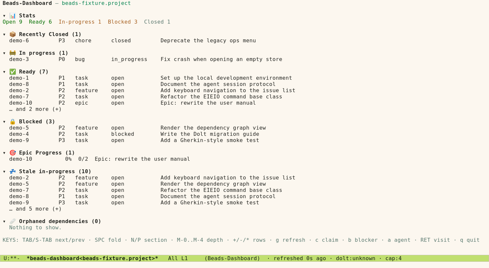
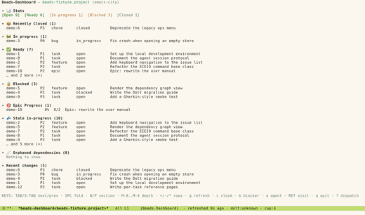
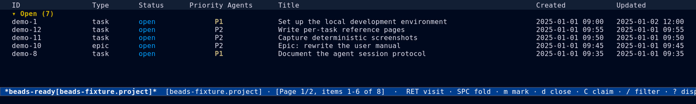
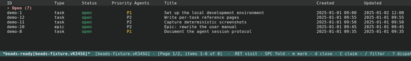
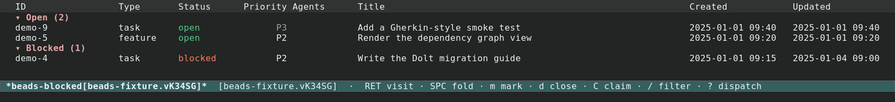
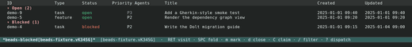

#+TITLE: Dashboards and Views
#+AUTHOR: Beads Contributors
#+LANGUAGE: en
#+OPTIONS: H:4 num:3 toc:2
#+STARTUP: showall
#+SETUPFILE: ../.orgconfig

# Task area: the board and dashboard, list/show sections, pagination, thing
# motion, eldoc previews.

Back to [[file:index.org][the manual index]].

* The board and the dashboard

{{{kbd(M-x beads)}}} opens the project board ({{{fn(beads-dashboard)}}}) — the
front door of beads.el.  The board is a =vui= buffer: each section is a
component that loads its own data asynchronously inside a
=vui-error-boundary=, so one slow or failing query never blocks the rest.

If you are unsure which Beads store a buffer acts on, the header names it, and
buffer-local store scoping keeps every command pointed at the same store; see
[[file:index.org][Getting started]].

Press {{{kbd(D)}}} from the dispatch menu, or {{{kbd(M-x beads-dashboard)}}},
to open the same board explicitly.

#+CAPTION: The project board (=beads-dashboard=) with ready, in-progress, and blocked sections.
#+NAME: fig:dashboard-dark
[[file:images/dashboard-dark.png]]
[[file:images/dashboard-dark-thumb.png]]

#+CAPTION: The board under the light theme.
#+NAME: fig:dashboard-light

** Sections and folding

Each section heading is a thing carrying a toggle.  {{{kbd(SPC)}}} on a
heading folds or unfolds that section; {{{kbd(+)}}} and {{{kbd(-)}}} expand and
collapse, and {{{kbd(*)}}} toggles everything.  Section state is remembered
per store, so reopening the board restores your layout.

** Ready and blocked lists

The *ready* list is the work frontier: issues that are open and have no unmet
dependencies.  The *blocked* list is its complement: issues waiting on
dependencies or a declared blocked status.  Open them from the dispatch menu
with {{{kbd(r)}}} and {{{kbd(b)}}}, or from the board header.

#+CAPTION: The ready-work list.
#+NAME: fig:ready-dark

#+CAPTION: The blocked-issues list.
#+NAME: fig:blocked-dark

* List and show sections

=beads-list-mode= renders homogeneous rows in a =tabulated-list-mode= table:
id, status, priority, type, and title, with clickable headers and a sort key.
=beads-show-mode= renders one issue as a set of collapsible =vui= sections
(description, dependencies, comments, history, ...).

The two views share the things below, so the same keys work in both.

** Movement

#+FINDEX: beads-thing-forward
#+FINDEX: beads-thing-backward
#+FINDEX: beads-thing-toggle
=beads-thing.el= is the one movement scheme:

- {{{kbd(TAB)}}} / {{{kbd(S-TAB)}}} :: =beads-thing-forward= /
  =beads-thing-backward=, wrapping at the ends (they echo =Wrapped=).
- {{{kbd(SPC)}}} :: =beads-thing-toggle=, which runs the thing's own toggle
  (fold, preview) and then the buffer-local =beads-thing-toggle-functions=.
- {{{kbd(n)}}} / {{{kbd(p)}}} :: Next / previous line, without wrapping.

In a tabulated list every row is a thing.  In section buffers the thing is a
run of text carrying the =beads-thing= property.

** Pagination

#+FINDEX: beads-pager-mode
Large result sets are paginated.  The pager sizes a page to the window (with a
floor of five rows) and lets you navigate:

- {{{kbd(])}}} / {{{kbd([)}}} :: Next / previous page.
- {{{kbd(G)}}} :: Jump to a page.
- {{{kbd(g)}}} :: Refresh the current view.

The pagination core is reusable and buffer-agnostic; see
[[file:maintenance.org][Maintenance and extending]].

* Eldoc previews

#+FINDEX: beads-eldoc
Hover over an issue reference anywhere in Emacs — a comment, a commit message,
an Org file — and eldoc previews the issue asynchronously.  Preview data is
cached per store, including negative results, so a reference to an unknown id
does not re-query on every keystroke.  Issue ids are matched with the shared
=beads-issue-id-regexp= and restricted by =beads-issue-id-prefixes=.

Set {{{var(beads-eldoc-mode)}}} (or call =beads-eldoc-mode=) in the buffers
where you want previews.  Remote stores are supported; previews use the same
asynchronous path as the board and never block.
